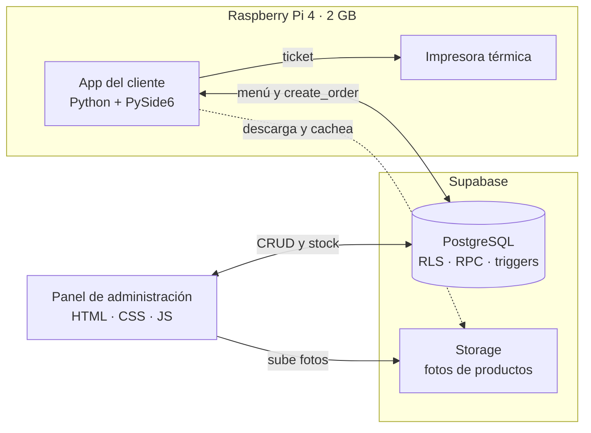
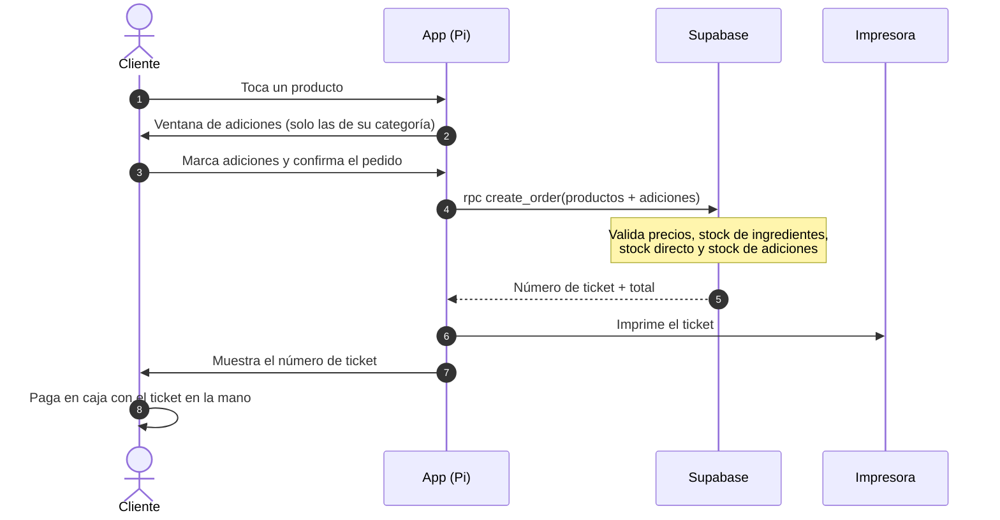
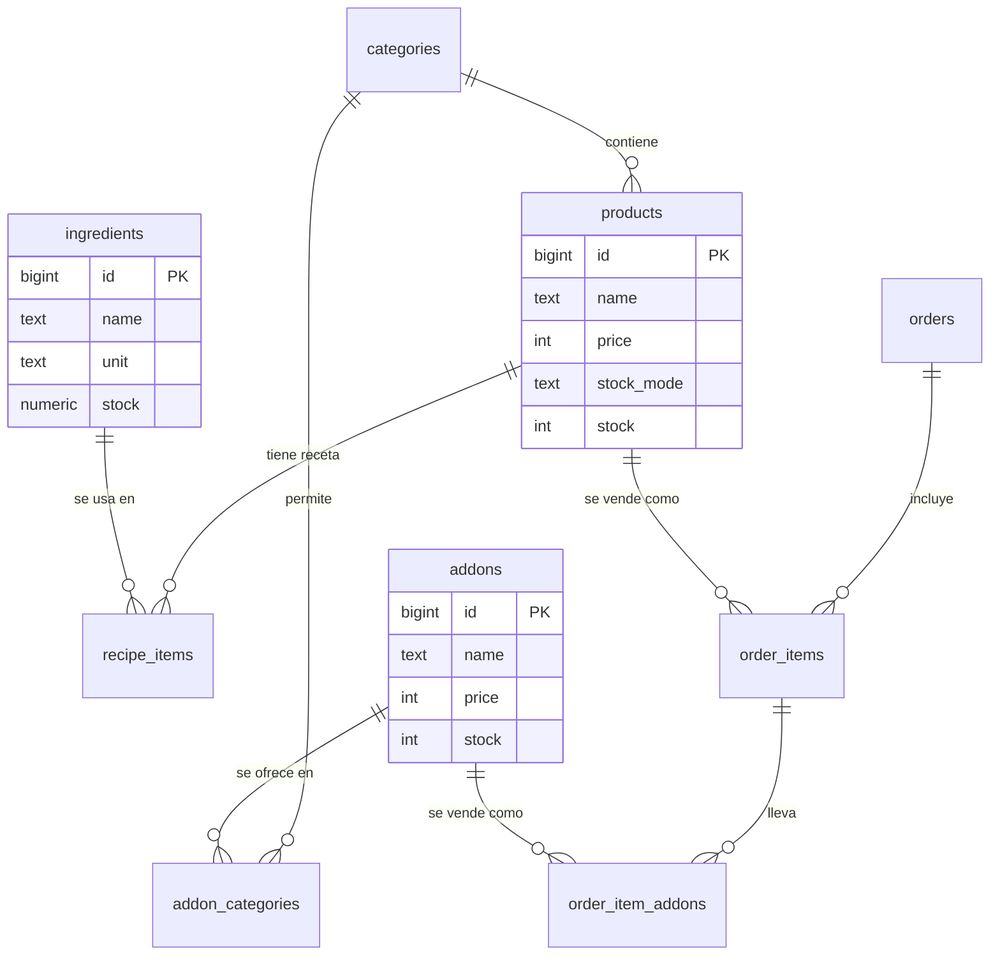

<div align="center">

```text
██╗  ██╗██╗ ██████╗ ███████╗██╗  ██╗ ██████╗ 
██║ ██╔╝██║██╔═══██╗██╔════╝██║ ██╔╝██╔═══██╗
█████╔╝ ██║██║   ██║███████╗█████╔╝ ██║   ██║
██╔═██╗ ██║██║   ██║╚════██║██╔═██╗ ██║   ██║
██║  ██╗██║╚██████╔╝███████║██║  ██╗╚██████╔╝
╚═╝  ╚═╝╚═╝ ╚═════╝ ╚══════╝╚═╝  ╚═╝ ╚═════╝ 
```

### Autoservicio para restaurantes · hecho para vivir en una Raspberry Pi

**Elige ➜ Personaliza ➜ Imprime ➜ Paga con el ticket en la mano**


<br>

[Características](#caracteristicas) · [Arquitectura](#arquitectura) · [Cerebro del stock](#stock) · [Instalación](#instalacion) · [Seguridad](#seguridad) · [Roadmap](#roadmap)

</div>

---

## ¿Qué es esto?

**Kiosko** es una aplicación de **autoservicio** para restaurantes. Una pantalla táctil conectada a una **Raspberry Pi 4** recibe al cliente: ve el menú por categorías, arma su pedido, personaliza cada plato con **adiciones** y al confirmar sale un **ticket impreso**. Con ese ticket en la mano, el cliente paga en caja. Nada de filas para tomar el pedido.

Detrás hay un cerebro que **no deja vender lo que no existe**: el stock de ingredientes, de productos y de adiciones se controla en tiempo casi real, y el servidor valida todo antes de aceptar un pedido.

> [!NOTE]
> Este repositorio es la **app del cliente** (la que corre en la Raspberry Pi).
> El **panel de administración** (productos, fotos, ingredientes, stock) es una página web en su propio repositorio:
> [`Santromix03/kiosko-admin`](https://github.com/Santromix03/kiosko-admin)

<!--
CAPTURAS (descomenta cuando guardes las imágenes en docs/img/)

<div align="center">
  
  <br><br>
  
  
</div>
-->

---

<a id="caracteristicas"></a>
## Características

| Experiencia del cliente | Inteligencia detrás del mostrador |
|---|---|
| Menú por **categorías con íconos** | Stock por **ingredientes** (unidad, gramos o mililitros) |
| Productos con **foto** (descargadas y guardadas en caché local) | Stock **directo** para productos como gaseosas |
| Carrito con botones **＋ / －** y total en vivo | El menú se **refresca solo cada 15 s** con el stock real |
| **Adiciones** con casillas, solo las que corresponden a la categoría del producto | El carrito **no deja pedir más de lo que hay** y muestra *Agotado* |
| **Ticket** con número del día y vista previa | Precios y stock **validados en el servidor**, nunca en la pantalla |
| Diseño minimalista rojo y blanco, pensado para **pantalla táctil** | Cada adición tiene su **propio stock** y categorías permitidas |

---

<a id="arquitectura"></a>
## Arquitectura



### Cómo fluye un pedido



### Modelo de datos



---

<a id="stock"></a>
## El cerebro del stock

Cada producto elige **cómo se controla su stock**:

| Modo | Ideal para | ¿Qué se descuenta al vender? |
|---|---|---|
| `none` | Productos sin control | Nada |
| `direct` | Una gaseosa, una botella | Las unidades del propio producto (lo hace un *trigger*) |
| `recipe` | Hamburguesa, latte | Los ingredientes de la receta (lo hace `create_order`) |

Los ingredientes se miden en **tres unidades**: `unidad` (panes), `g` (café, carne) y `ml` (leche).

> **Hamburguesa:** 1 pan + 1 carne + 20 g lechuga + 1 loncha de queso
>
> **Latte:** 10 g de café molido + 90 ml de leche

El límite que ve el cliente se calcula así:

```text
límite del producto = el menor entre
   · el tope general por producto (20)
   · el stock directo                      (si es de stock directo)
   · ⌊ stock del ingrediente ÷ cantidad ⌋  (por cada ingrediente de la receta)
```

Las **adiciones** (aloe, fibra, té herbal…) funcionan aparte: precio, **stock propio** y una lista de **categorías permitidas**. Un trigger en la base de datos rechaza cualquier combinación inválida, aunque alguien intentara saltarse la interfaz.

<details>
<summary><b>Objetos de la base de datos</b></summary>

<br>

| Objeto | Tipo | Para qué sirve |
|---|---|---|
| `menu_products` | Vista | Menú público con el límite (`max_qty`) ya calculado |
| `create_order(p_items)` | Función RPC | Crea el pedido y descuenta stock, todo en una sola transacción |
| `adjust_addon_stock` | Función RPC | Suma o resta stock de una adición (nunca baja de 0) |
| `adjust_ingredient_stock` | Función RPC | Suma o resta stock de un ingrediente (nunca baja de 0) |
| `apply_direct_stock` | Trigger | Descuenta el stock directo al insertar una línea de pedido |
| `check_addon_category` | Trigger | Impide vender una adición en una categoría no permitida |

</details>

---

<a id="instalacion"></a>
## Instalación

### Paso 1: Requisitos

- Python **3.11+**
- Un proyecto en [Supabase](https://supabase.com) con el esquema de la base de datos ya creado
- Raspberry Pi OS **64-bit** (el que instala Raspberry Pi Imager) para el despliegue final

### Paso 2: Clonar e instalar

**Windows (desarrollo):**

```powershell
git clone <url-del-repositorio>
cd Kiosko
python -m venv venv
venv\Scripts\Activate.ps1
pip install -r requirements.txt
```

**Linux / Raspberry Pi:**

```bash
git clone <url-del-repositorio>
cd Kiosko
python3 -m venv venv
source venv/bin/activate
pip install -r requirements.txt
```

`requirements.txt`:

```text
PySide6
supabase
python-dotenv
# python-escpos   ← se agrega al conectar la impresora térmica (en la Pi)
```

### Paso 3: Configurar el entorno

Crea un archivo `.env` en la raíz (**nunca se sube a Git**):

```env
SUPABASE_URL=https://TU-PROYECTO.supabase.co
SUPABASE_ANON_KEY=tu_clave_anon_aqui
NOMBRE_LOCAL=Mi Restaurante
TICKET_WIDTH=32
PRINTER_MODE=file
```

| Variable | Descripción |
|---|---|
| `SUPABASE_URL` | Solo la URL base del proyecto, sin `/rest/v1` ni barra final |
| `SUPABASE_ANON_KEY` | Clave **anon** o *publishable*. Nunca la `service_role` |
| `NOMBRE_LOCAL` | Nombre que aparece en el título y en el ticket |
| `TICKET_WIDTH` | Columnas del ticket: `32` para papel de 58 mm, `48` para 80 mm |
| `PRINTER_MODE` | `console` (imprime en la terminal) · `file` (guarda en `tickets/`) · `escpos` (térmica, pendiente) |

### Paso 4: Assets

| Qué | Dónde va | Fuente |
|---|---|---|
| Íconos de categorías (`coffee`, `glass-water`, `hamburger`, `cup-soda`, `utensils`) | `assets/icons/*.svg` | [Lucide](https://lucide.dev) |
| `Poppins-Regular.ttf`, `Poppins-Bold.ttf` | `assets/fonts/` | [Google Fonts](https://fonts.google.com/specimen/Poppins) |
| `PlayfairDisplay-Bold.ttf` | `assets/fonts/` | [Google Fonts](https://fonts.google.com/specimen/Playfair+Display) |

Las fuentes viajan dentro del proyecto para que se vean igual en la Raspberry Pi.

### Paso 5: ¡A correr!

```bash
python main_cliente.py
```

---

## Stack

| Capa | Tecnología |
|---|---|
| Interfaz | **PySide6** (Qt for Python) + hojas de estilo QSS |
| Backend | **Supabase**: PostgreSQL, RLS, funciones RPC, triggers y Storage |
| Hardware | Raspberry Pi 4 (2 GB) + pantalla táctil + impresora térmica |
| Administración | HTML · CSS · JavaScript puro + Supabase JS |

---

## Estructura del proyecto

```text
Kiosko/
├── main_cliente.py          ← punto de entrada de la app del cliente
├── config.py                ← lee el .env
├── requirements.txt
├── core/                    ← lógica pura, sin interfaz
│   ├── supabase_client.py   ← cliente único de Supabase
│   ├── models.py            ← Category, Product, Addon, CartItem
│   ├── cart.py              ← carrito, límites de stock y adiciones
│   └── workers.py           ← hilos para que la UI nunca se congele
├── services/                ← todo lo que habla con el exterior
│   ├── catalog_service.py   ← menú, productos y adiciones
│   ├── order_service.py     ← envía el pedido (create_order)
│   ├── image_cache.py       ← descarga y cachea fotos
│   └── printer_service.py   ← arma e imprime el ticket
├── ui/
│   ├── common/              ← estilos (QSS), widgets y assets reutilizables
│   └── cliente/             ← ventana principal, carrito, adiciones y ticket
├── assets/                  ← íconos y fuentes
├── cache/                   ← fotos descargadas (no se sube a Git)
└── tickets/                 ← tickets generados en modo `file` (no se sube a Git)
```

**Regla de oro:** la interfaz **nunca** habla con Supabase directamente. Todo pasa por `services/`, y las llamadas de red corren en hilos aparte.

---

<a id="seguridad"></a>
## Seguridad

- La app usa solo la clave **anon**. La seguridad real vive en las políticas **RLS** de Supabase.
- El público solo puede **leer** el menú, las adiciones activas y sus categorías.
- Los pedidos se crean **únicamente** a través de `create_order`, que calcula el total con los precios de la base de datos. Modificar precios desde la pantalla no sirve.
- Productos, ingredientes, recetas y ventas solo los edita un **administrador autenticado**.
- El bucket de fotos es de lectura pública; subir o borrar requiere sesión de administrador.
- El `.env` está en el `.gitignore`.

> [!WARNING]
> Nunca pongas la clave `service_role` en el código, en el `.env` de la app ni en el repositorio.

---

## Solución de problemas

<details>
<summary><b>PGRST125 · Invalid path specified in request URL</b></summary>

<br>

`SUPABASE_URL` trae una ruta de más. Debe ser solo `https://TU-PROYECTO.supabase.co`, sin `/rest/v1` y sin barra final.

</details>

<details>
<summary><b>No se pudo cargar el menú</b></summary>

<br>

Revisa que el SQL del esquema esté ejecutado (tablas, vista `menu_products`, funciones) y que el `.env` tenga la URL y la clave correctas.

</details>

<details>
<summary><b>Failed building wheel for PyYAML (en Windows)</b></summary>

<br>

Viene de `python-escpos`. Esa librería solo hace falta con la impresora térmica real, así que instálala **únicamente en la Raspberry Pi**.

</details>

<details>
<summary><b>"Sin stock suficiente de: …" al confirmar</b></summary>

<br>

Otro pedido se llevó las últimas unidades antes de confirmar. Es normal: el servidor tiene la última palabra y el menú se refresca solo cada 15 segundos.

</details>

<details>
<summary><b>Categorías sin ícono, productos sin foto o letra diferente</b></summary>

<br>

Faltan archivos en `assets/icons/` o `assets/fonts/`. Los productos sin foto muestran *Sin imagen*.

</details>

---

<a id="roadmap"></a>
## Roadmap

- [x] Menú por categorías con íconos y fotos
- [x] Carrito con límites de stock y refresco automático
- [x] Adiciones con stock propio y categorías permitidas
- [x] Stock por ingredientes (unidad, g, ml) y stock directo
- [x] Ticket con número diario, vista previa e impresión a archivo o consola
- [x] Panel de administración web (repositorio aparte)
- [ ] Impresión en **impresora térmica ESC/POS** desde la Pi
- [ ] **Modo kiosco**: pantalla completa y reinicio del pedido por inactividad
- [ ] **Autoarranque** en la Raspberry Pi al encender
- [ ] **Ventas del día** en el panel de administración
- [ ] Consolidar todo el SQL en `database/schema.sql`
- [ ] Pruebas automáticas de la lógica del carrito

---

## Créditos

- Íconos por [Lucide](https://lucide.dev) (licencia ISC)
- Tipografías **Poppins** y **Playfair Display** (licencia OFL)
- [Qt for Python](https://doc.qt.io/qtforpython-6/) · [Supabase](https://supabase.com)

<div align="center">

<br>

**Hecho con café, mucho Python y un poquito de caos por [Santromix03](https://github.com/Santromix03) y el equipo**

<sub>Proyecto académico · en construcción constante</sub>

</div>